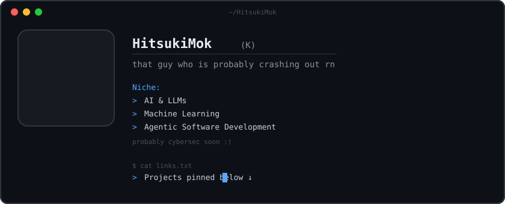
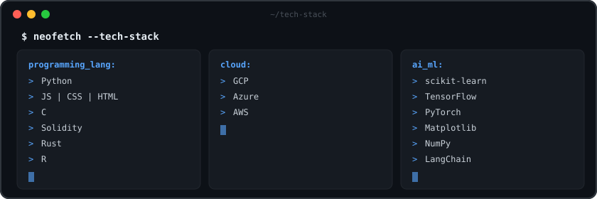
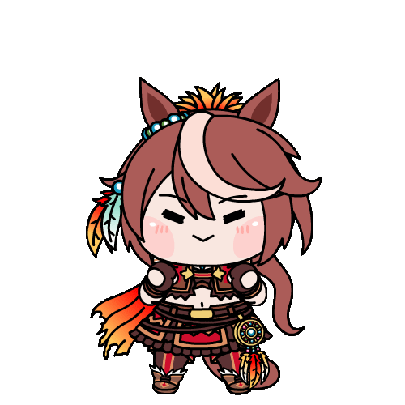

  

  

  

---

<h3 align="center">Tech Stack</h3>

  

---

<h3 align="center">GitHub Stats</h3>

<table align="center" width="840">
  <tr>
    <td width="280" align="center">
      
    </td>
    <td width="280" align="center">
      
    </td>
    <td width="280" align="center">
      
    </td>
  </tr>
</table>

---

<h3 align="center">Contribution Graph</h3>

  

---

  
   
  <samp>projects pinned below ↓</samp>

